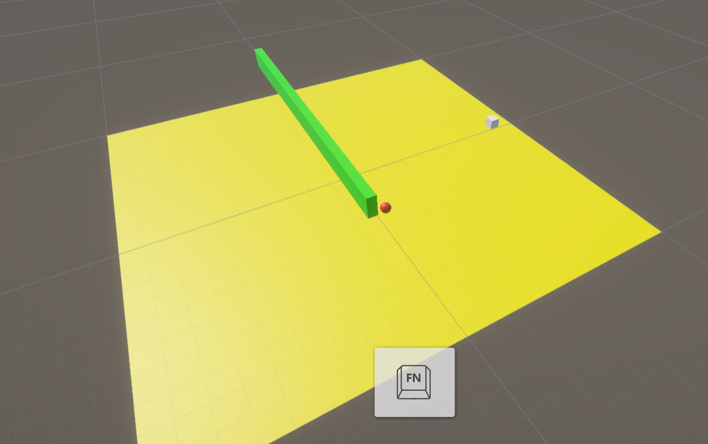
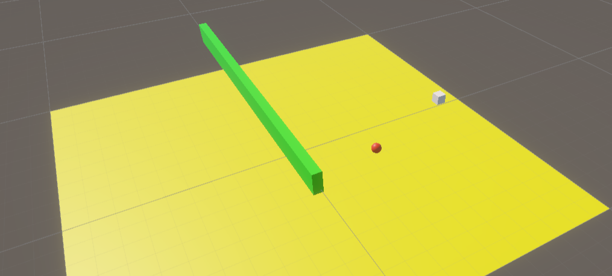
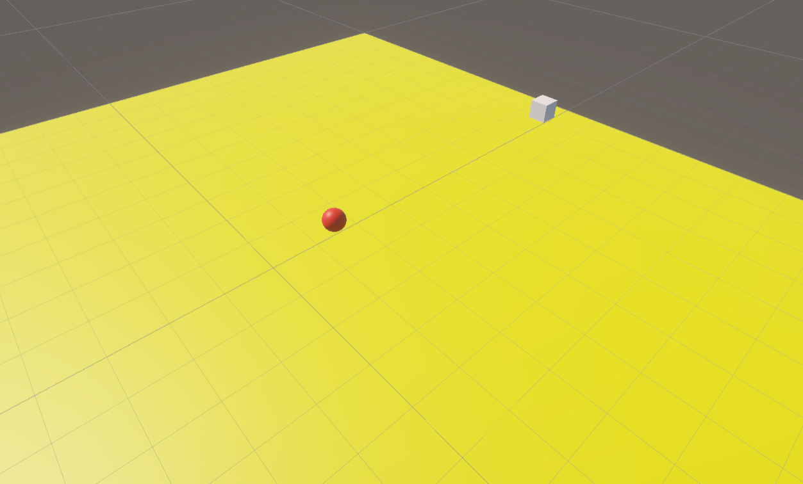
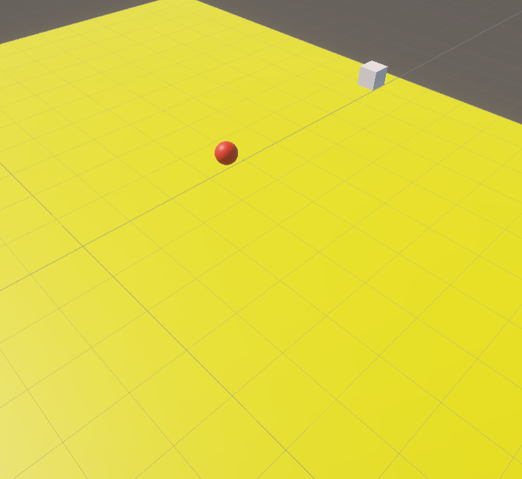
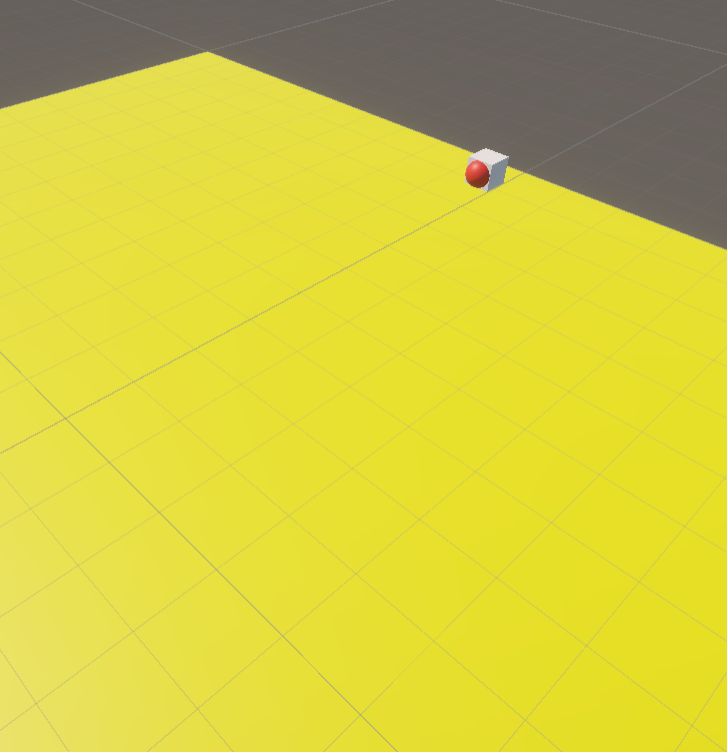

About the Project

This is my first version of a robot navigation system made in Unity with C#.

I wanted to make a robot that can move towards a target and avoid obstacles without using NavMesh, pathfinding packages or any additional plugins.

So I tried to make my own simple system using vectors, Raycasts and some decision-making logic.

How It Works

The robot calculates the direction and distance between itself and the target.

Version 1.0

This is still an early version. The robot can avoid some obstacles, but it doesn't always find the correct way around them.

Sometimes it can get stuck, so I want to improve the system in future versions.

## Screenshots

